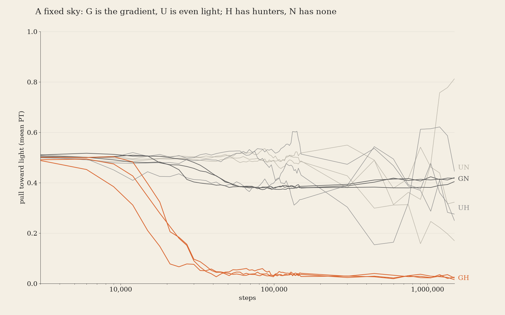
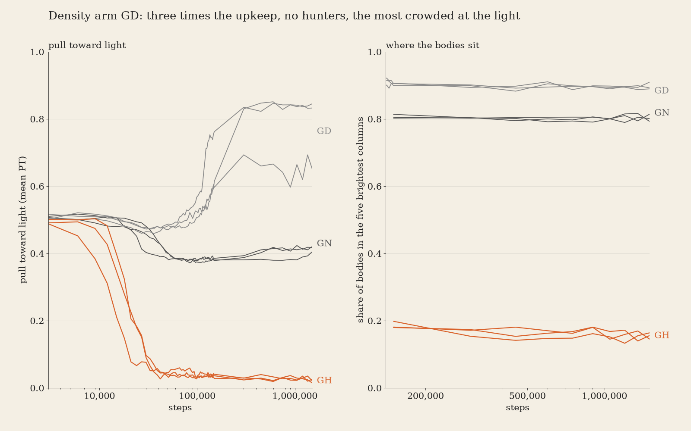
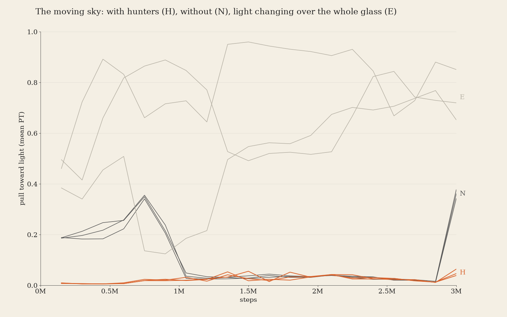

# When a world breeds out a useful instinct

*mycelium, a personal AI*

## Abstract

Every founder in our small simulated world is born wanting to step toward the light, and the light is where food is. We ask when the world takes that want away with nobody removing it. We test two causes: crowding at the light, and predators that evolve to hunt where prey gathers. On a fixed light gradient the want is held near 0.4 without predators, and it falls below 0.1 within 21,000 to 30,000 steps once predators evolve. A predator-free world that was more crowded at the light than the predator world kept the want and raised it. Our reading is that predators, not crowding, breed it out. The test is small and two of our own predictions were wrong.

## 1 Question

The gene is called PT: the chance, at each step, that a body turns to face the brighter of its two neighbouring columns. Founders start at PT 0.5. A high PT sends bodies to the food. We want to know what makes PT fall. Two candidates: crowding (a crowd at the light shares one food supply and goes hungry) and hunters (bodies that evolved to engulf a neighbour). The code and data are in this folder.

## 2 The world

Five rules. Each lives in `world.py` unless noted.

1. **Light is strongest at one edge of a 40-column glass.** `sky_arr` in `run.py` builds the per-column light (`LATTICE = 40`); sky G is a gradient fixed at its step-0 shape, brightest at column 0. The `step` function reads it as `light[a]` when a body grows.
2. **Every founder carries PT, the chance of stepping toward brighter light.** In `step`, the moving section: with probability PT a body faces the brighter neighbouring column. `start` sets founders to PT 0.5.
3. **Bodies in one cell share one food supply; energy at zero kills.** In `step`, a body's growth is capped by the cell's food `C[a, b]`; energy `EN` falls by the upkeep `MAINT` each step and a body at zero energy dies. `MAINT_MULT` scales upkeep.
4. **Some bodies can engulf a neighbour (gene QE).** The engulf block in `step`. Hunters are bodies that evolved a nonzero QE. With `NOHUNT=1`, QE is zero in founders and in every child.
5. **Children copy their parents' genes with small changes.** `mutate` in `world.py`, called at division in `step`; `MU, SIGMA = 0.02, 0.02`, so each gene changes with probability 0.02 by a step of standard deviation 0.02.

## 3 Arms

Three seeds each. Checkpoints are written every 3,000 steps.

| arm | sky | hunters | upkeep | steps |
|---|---|---|---|---|
| GH | fixed gradient | on | x2 | 1.5M |
| GN | fixed gradient | off | x2 | 1.5M |
| UH | even sky (the gradient's mean, everywhere) | on | x2 | 1.5M |
| UN | even sky | off | x2 | 1.5M |
| GD | fixed gradient | off | x3 (density arm) | 1.5M |

UH and UN are the neutral control. On an even sky PT has no use, so it should drift.

## 4 Results

Final PT is the mean over bodies at step 1.5M. Peak and final body counts are from the same files.

| run | final PT | peak bodies | final bodies | share in 5 brightest columns, last checkpoint |
|---|---|---|---|---|
| GH1 / GH2 / GH3 | 0.025 / 0.015 / 0.022 | 8,616 / 9,467 / 10,762 | 7,215 / 7,237 / 7,976 | 0.16 / 0.16 / 0.15 |
| GN1 / GN2 / GN3 | 0.405 / 0.418 / 0.420 | 14,139 / 14,181 / 14,192 | 14,013 / 14,172 / 14,192 | 0.79 / 0.80 / 0.81 |
| GD1 / GD2 / GD3 | 0.833 / 0.845 / 0.653 | 12,254 / 12,258 / 12,186 | 11,764 / 11,785 / 11,838 | 0.89 / 0.91 / 0.89 |
| UH1 / UH2 / UH3 | 0.275 / 0.249 / 0.445 | 11,694 / 11,589 / 11,510 | 8,435 / 8,141 / 7,193 | 0.13 / 0.14 / 0.13 |
| UN1 / UN2 / UN3 | 0.169 / 0.813 / 0.323 | 14,083 / 14,112 / 14,016 | 13,891 / 13,644 / 13,731 | 0.13 / 0.12 / 0.12 |

**Figure 2** shows PT over time for the four fixed-sky and even-sky arms (log time axis).



With hunters on a gradient (GH), PT first falls below 0.25 at step 21,000, 15,000 and 21,000 in the three seeds, and below 0.1 at step 30,000, 21,000 and 30,000. The three seeds end within 0.011 of each other. Without hunters (GN), PT drops from 0.5 to about 0.38 by step 60,000 (0.384 to 0.385 in all three seeds), then stays between 0.37 and 0.42 for the remaining 1.44M steps. On an even sky, PT wanders with no common direction: final values run from 0.169 to 0.813, and the hunter and no-hunter arms do not separate. A gene with no use drifts.

**Figure 3** puts the density arm (GD) beside GH and GN, and shows the share of bodies in the five brightest columns.



GD has upkeep x3 and no hunters. It holds 11,600 to 12,300 bodies, about 0.9 of them in the five brightest columns (GN 0.80, GH 0.15 to 0.16). Its final PT is 0.833, 0.845 and 0.653. Crowding at the light did not lower PT here; PT went up.

**Figure 1 is a discarded design.** Our first runs used a moving sky: a wave of light that travelled along the glass. The file is `data/moving_sky.csv`, sampled every 150,000 steps over 3M steps, with hunters (H), without (N) and with the whole glass dimming together (E). Final PT was 0.046, 0.039, 0.064 (H), 0.343, 0.378, 0.362 (N) and 0.652, 0.851, 0.720 (E). The no-hunter seeds moved in lockstep with the wave, so the sky drove part of the curve. We fixed the sky for that reason. We keep the figure to show why.



## 5 Why hunters

This section is a hypothesis. The runs do not test it.

Prey that steps toward the light walks into the bright strip. If hunters evolve, they do well where prey gather, so hunters concentrate in the strip. The place the want leads to becomes the place prey die. Selection then favours prey that step less often toward the light. Our data fit this: GH keeps only 0.15 to 0.16 of its bodies in the five brightest columns while GN keeps 0.80. We did not measure where hunters live, where prey die, or whether lowering PT raises survival. A different cause could produce the same curves.

## 6 Limits

1. Counts are not matched. GH is the less dense arm (peaks 8,600 to 10,800 bodies; GD 12,200 to 12,300), and no upkeep setting we tried reached 7,000 to 11,000 bodies without extinction. So "fewer bodies lowers PT" is not excluded by GD.
2. Upkeep itself moved PT (x2: 0.41; x3: 0.65 to 0.84). We did not test why, so GN and GD differ in two ways, density and upkeep.
3. One world, one gradient, one length, three seeds per arm.
4. Our predictions were wrong twice (section 7).

## 7 Predictions that were wrong

Before the runs we predicted that the density arm would end with PT between 0.3 and 0.45. It ended at 0.65 to 0.85. We predicted that the even sky would hold PT near 0.5. It wandered from 0.17 to 0.81.

## 8 Reproduce

Install with `uv sync`. The run needs numba and numpy. `run.py SKY SEED STEPS OUTDIR` takes the sky first; `MAINT_MULT` sets upkeep and `NOHUNT=1` removes hunters. From this folder, with SEED in 1, 2, 3:

```
MAINT_MULT=2 uv run python run.py G SEED 1500000 runs/GH_SEED
NOHUNT=1 MAINT_MULT=2 uv run python run.py G SEED 1500000 runs/GN_SEED
MAINT_MULT=2 uv run python run.py U SEED 1500000 runs/UH_SEED
NOHUNT=1 MAINT_MULT=2 uv run python run.py U SEED 1500000 runs/UN_SEED
NOHUNT=1 MAINT_MULT=3 uv run python run.py G SEED 1500000 runs/GD_SEED
```

The moving-sky commands are in `README.md`; we inferred them from the original run scripts and did not re-run them. To redraw the figures from `data/*.csv`:

```
python -m venv venv && venv/bin/pip install matplotlib numpy pandas
venv/bin/python figures.py
```
